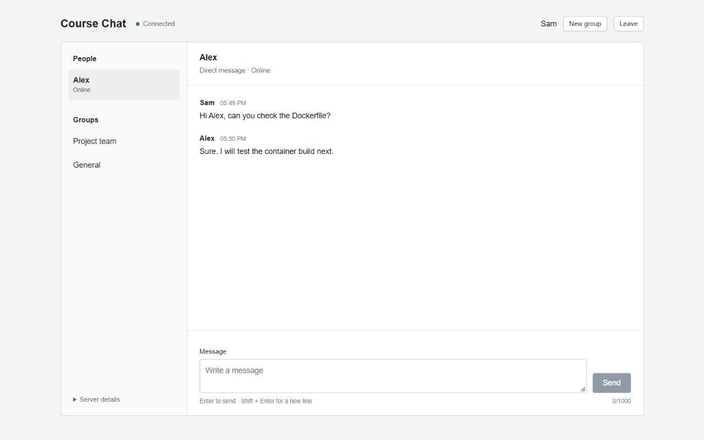

# 6.0 Dockerized Chat Application with Kubernetes

A regular chat application with **one-to-one messages and simple group chats**. Built with React, Node.js, Socket.IO, Redis, Docker and Kubernetes.



For a free hosted demo, see [GitHub and Render deployment](docs/FREE-DEPLOYMENT.md). The included `render.yaml` defines only free-plan resources. Kubernetes deployment and scaling exercises remain separate from that single-instance hosted demo.

## Features

- Enter a display name and see people with online/offline status.
- Select a person to exchange direct messages. Other users do not receive that conversation.
- Create a named group, or open an existing group. Groups are open to everyone in this course demo.
- Typing indicators, unread counters, recent conversation history and reconnect support.
- A plain React interface with neutral colors and standard controls. No UI framework is required.
- Two Kubernetes chat replicas, a Redis Service, probes, persistent storage, rolling updates and manual scaling.

The app uses a random private session token stored in the current tab. Refreshing or reconnecting preserves that identity. **Leave** clears it; closing the tab normally ends access to that identity too. Opening a separate new tab creates a different user, which is useful for a demo. Names are unverified and can be duplicated. This is a course project, without account registration, uploads, calls, or end-to-end encryption.

## Run with Docker Compose

Start Docker Desktop with Linux containers, or Docker Engine with the Compose plugin. From this directory:

```sh
docker compose up --build -d
docker compose ps
```

Open **http://localhost:3000** in two separate tabs and enter different names. Select the other person under **People** and send a message. Use **New group** to create a group, then open it in both tabs to try group chat.

```sh
docker compose logs -f chat
docker compose down
```

The named Redis volume preserves data across container restarts. `docker compose down -v` intentionally erases this project's Compose data.

## Run locally with Node.js

Prerequisites: **Node.js 24+** and Redis 7+. To start just Redis on local loopback using Docker:

```sh
docker compose -f compose.yaml -f compose.dev.yaml up -d redis
npm ci
```

Copy `.env.example` to `.env`: `Copy-Item .env.example .env` in PowerShell, or `cp .env.example .env` in a Unix shell.

For a single server serving the React build:

```sh
npm run build
npm start
```

Open **http://localhost:3000**. To edit React with live reload, use two terminals instead:

```sh
# Terminal 1: Node backend
npm run dev
```

```sh
# Terminal 2: React/Vite frontend
npm run dev:client
```

Open **http://localhost:5173** in development. Vite proxies `/api` and `/socket.io` to Node.js. Set a different `PORT` in `.env` if 3000 is occupied. Redis is required; there is no fake chat backend.

## Kubernetes setup — Minikube

Prerequisites: Docker, kubectl and Minikube, with a default StorageClass for the Redis PVC. Minikube provides a storage provisioner by default.

```sh
minikube start --driver=docker
docker build -t course-chat:1.0.0 .
minikube image load course-chat:1.0.0
kubectl apply -f k8s/namespace.yaml
kubectl apply -f k8s/
kubectl -n course-chat rollout status deployment/redis --timeout=180s
kubectl -n course-chat rollout status deployment/chat --timeout=180s
kubectl -n course-chat get pods,svc,pvc
minikube service chat -n course-chat --url
```

Open the printed URL. Keep the terminal running if Minikube creates a tunnel. The chat Service exposes NodePort **30080**, forwarding port 80 to chat pods on port 3000.

Fallback:

```sh
kubectl -n course-chat port-forward service/chat 8080:80
```

Open http://localhost:8080. A Service port-forward picks one pod; use NodePort or separate pod forwards to demonstrate multiple replicas. Existing WebSocket connections stay with their original pod when replicas are added.

For Docker Desktop Kubernetes, enable its cluster and use that context, making the built image available to its engine. For remote clusters, push your image to a registry and update the deployment's image reference. A local image tag is not automatically available on remote nodes.

Follow [the DevOps lab](docs/DEVOPS-LAB.md) for service discovery, scaling, rolling updates, rollback and self-healing.

## Verification

```sh
npm ci
npm run check
npm run build
npm test
```

With Redis running locally:

```sh
npm run test:integration
```

Set `TEST_REDIS_URL` if needed; tests do not read `.env`. The integration test starts two real Node servers and three clients. It checks direct-message isolation, sender identity, group creation/membership, typing, history limits/expiry, readiness while draining, and session recovery on a surviving replica. It uses a unique Redis prefix and cleans up its own test data.

[Verification record](docs/VERIFICATION.md) distinguishes completed checks from Docker/Kubernetes exercises that still need a working engine/cluster.

## Project structure

```text
client/src/
  App.jsx             People/groups navigation and message input
  JoinForm.jsx        Display-name form
  MessageList.jsx     Message rendering and scrolling
  useChat.js          Session, socket events, unread counts and reconnects
  styles.css          Plain responsive CSS
  main.jsx            React entry
client/index.html
src/
  app.js              HTTP, sessions, direct/group delivery, Redis, lifecycle
  config.js           Validation, conversation IDs and rate limits
  server.js           Startup and signal handling
k8s/                  Namespace, ConfigMap, deployments, Services, Redis PVC
test/                 Unit and real-Redis integration tests
docs/                 Project guide, DevOps lab, verification, screenshot
dist/                 Generated React build
vite.config.js        React build and development proxy
Dockerfile            Multi-stage React build + Node runtime
compose.yaml          App and Redis
compose.dev.yaml      Optional loopback Redis port for local development
```

## Configuration

`PORT=3000`, `REDIS_URL=redis://127.0.0.1:6379`, `APP_VERSION=1.0.0`, `DRAIN_MS=5000`. `INSTANCE_ID` defaults to the hostname; Kubernetes injects the pod name. Containers use environment variables supplied by Compose/Kubernetes; local npm scripts can read `.env`.

- `/health/live`: process health.
- `/health/ready`: HTTP 200 when Redis is ready and shutdown has not begun; otherwise 503.
- `/api/info`: app version, replica and Redis availability.
- `/socket.io/`: WebSocket endpoint.

Open **Server details** in the desktop sidebar to see the socket's actual replica. That can differ from the pod that served the HTML page.

## Storage and limits

Redis Pub/Sub distributes live events between replicas. Separate Redis lists retain the latest **100 messages per conversation**, expiring after **24 hours without a new message**. User profiles, group definitions and joined-group memberships persist until the project's Redis data is removed. Offline profiles remain available so an existing tab identity can resume its direct conversations. Closing a tab or clicking Leave does not erase that profile.

Unread counts are page-local and reset on refresh. There are no push notifications or delivery/read receipts. A message with a lost acknowledgement may already have been stored; the app retains the draft and asks you to check before retrying. Simultaneous messages may appear in slightly different live order across replicas.

The random tab token controls access to a direct-message identity. Names are not authentication, and copied tokens grant that identity's access. Do not share tokens. This is not a production account system. Groups are explicitly public within the app; there are no private invitations or moderation controls.

Rolling updates preserve available HTTP replicas, but sockets on terminating pods reconnect. Recent history restores retained messages after reopening the conversation. The single Redis pod is a deliberate course-level dependency and is not highly available. Its PVC and append-only persistence preserve data through pod recreation, subject to disk/Redis durability.

This project is for a trusted classroom/local network. Redis stays internal in the default deployments; the development override exposes it only on loopback. Public hosting would require verified accounts, TLS, Redis access controls, network isolation, backups and shared abuse limits. WebSocket-only transport avoids sticky-session setup; networks blocking WebSockets have no polling fallback.

## Troubleshooting and cleanup

- Docker daemon/pipe error: start Docker Desktop, select Linux containers and wait for the engine.
- `ImagePullBackOff`: build/load the exact tag into Minikube, or push it to an accessible registry.
- Redis PVC pending: inspect `kubectl get storageclass` and `kubectl -n course-chat describe pvc redis-data`.
- Chat not ready: inspect Redis, ConfigMap and `kubectl -n course-chat logs deployment/chat`.
- No other people: open a separate fresh tab, enter a second name, and wait for the directory update.
- Same display names: they can represent different identities. Use distinct names for your course demo.
- Refresh resumes a session; Leave starts a new identity on the next Continue. A closed tab's token may not be recoverable.
- PowerShell blocks `npm.ps1`: use `npm.cmd`.

```sh
kubectl delete namespace course-chat
```

This intentionally removes the project's Kubernetes resources and Redis PVC. Use `docker compose down` to stop the Compose deployment; add `-v` only to erase its stored data.
