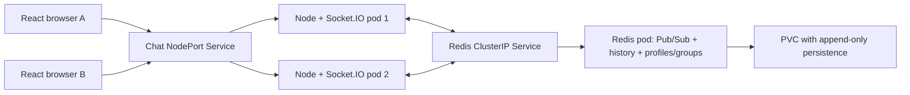

# Project guide

## Purpose

Build regular direct and group messaging, then practice container orchestration: deployments, service exposure/discovery, replica scaling, rolling updates and rollback. The UI uses React components and plain neutral CSS.

## Architecture

The Docker build compiles React with Vite. Node serves the resulting assets, HTTP health/API endpoints and WebSockets. Redis has two roles: Pub/Sub for live inter-replica delivery, and ordinary data structures for history, profiles, group definitions and membership. The adapter alone does not retain messages.

## Identity and message routing

The server generates a random 32-byte token for a new tab session. A SHA-256 hash of it gives a public user ID; the raw token is returned only to that client, never included in the people directory or message payloads. The tab stores it in sessionStorage and presents it on reconnect. Display names can be duplicated and are not verified accounts.

Every registered socket joins `user:<userId>`. A direct message is broadcast only to the sender's and recipient's user channels. The direct history ID is made by sorting the two public IDs. Clients send a target person, not an arbitrary history key; the server always derives the pair from the authenticated tab identity. Choosing someone else's name cannot retrieve their session or conversations.

Groups are open to all registered users. Creating/opening one records membership in Redis and joins its Socket.IO channel. Previously joined memberships are restored after reconnecting. Sending to a group before joining is rejected; any user may explicitly open a public group to join and read its retained history.

The browser subscribes before history is read. It buffers live messages while opening a conversation, merges them with history and deduplicates by server-generated message ID. This avoids missing or double-rendering messages around that boundary. All names and text are rendered as JSX strings, so React escapes HTML-like content.

## Modules

- `src/app.js`: Redis setup, tab sessions, people directory, direct/group authorization, history, probes and shutdown.
- `src/config.js`: name/message validation, symmetric direct IDs, per-connection rate limiting.
- `src/server.js`: startup and SIGTERM/SIGINT handling.
- `client/src/useChat.js`: sockets, resumable tab identity, opening conversations, typing, unread counts and reconnects.
- `client/src/App.jsx`: people and group lists, group creation and the message composer.
- `JoinForm.jsx`: display-name form. `MessageList.jsx`: escaped message rendering and scroll behavior.
- `styles.css`: ordinary CSS; on mobile a select replaces the sidebar.

## Socket events

Acknowledged events reply with `ok: true`, or `ok: false` plus an `error` string. The UI times out after six seconds and does not automatically resend uncertain messages.

Client to server:

- `session:join`: `{ username, token? }`. Returns `{ user, token, users, groups, instance, version }` with `ok: true`.
- `conversation:open`: `{ type: 'direct' | 'group', id }`. Returns a conversation descriptor and retained history. Opening a public group also joins it.
- `group:create`: `{ name }`. Creates a named public group and joins its creator.
- `chat:send`: `{ target: { type, id }, text }`. Server assigns sender ID/name, message ID, timestamp, conversation ID and replica.
- `chat:typing`: `{ target: { type, id }, active }`. Best-effort indication, subject to validation and limits.

Server to client:

- `server:info`: the socket's replica and version.
- `directory:update`: public users (ID, name, online flag) and group definitions. Presence is fetched across replicas, with a 10-second periodic refresh.
- `chat:message`: message fields including `conversationId`, `senderId`, `username`, `text`, timestamp and either `recipientId` or `groupId`.
- `chat:typing`: conversation ID, public user ID, name and active flag. Stale indicators expire in the UI.

## Kubernetes behavior

The chat Deployment has two replicas. A NodePort Service selects their `app: chat` labels. Redis has a ClusterIP Service named `redis`, allowing all chat pods to use `redis://redis:6379` even when pod IPs change. WebSocket-only connections stay on one pod, while the Redis adapter routes events across pods.

Readiness depends on Redis and draining state. Liveness only checks that the Node process responds. Startup probes allow initialization time. On SIGTERM the app becomes unready, waits five seconds for endpoint routing to update, and closes sockets so clients can reconnect. The pod has a 30-second termination grace period.

The rolling strategy uses `maxSurge: 1`, `maxUnavailable: 0` and five seconds of minimum readiness. It preserves available replicas during controlled replacement when capacity and readiness allow, but does not preserve individual socket sessions. Redis is one pod using Recreate strategy and a ReadWriteOnce PVC; its restart can interrupt all chat replicas.

## Viva questions

**Why Redis?** To forward live events between independent Node replicas and retain shared history/state.

**Why not broadcast every message to all sockets?** Direct messages must reach only the two tab identities. Public group events go only to joined group channels.

**Can someone enter my display name and read my DMs?** Not just by choosing the same name. Direct access follows the private session token. The demo does not verify people's real identities.

**Does Pub/Sub store history?** No. The app writes separate capped Redis lists with expiry.

**What stays after refresh?** The tab token resumes the same public user ID; retained messages can be reopened. Unread counts reset because they are local UI state.

**What happens after Leave or closing a tab?** The tab identity may be lost. Profile/history data remains in Redis, but reusing the name creates a different identity without the old token.

**Does scaling move existing sockets?** No. New connections can reach new pods; existing connections stay put.

**Why separate liveness/readiness?** A process can be alive while Redis is unavailable. It should stop receiving new traffic without being restarted repeatedly.

**Does a rolling update guarantee uninterrupted chat?** Healthy replicas remain available, while affected sockets reconnect and restore retained history. Exactly-once delivery and uninterrupted sockets are not guaranteed.

**What is outside scope?** Password accounts, private group invitations, encryption between end users, calls, uploads, moderation, Redis HA/backups and production monitoring.

## Primary references

- [Socket.IO Redis adapter](https://socket.io/docs/v4/redis-adapter/)
- [Socket.IO multiple nodes](https://socket.io/docs/v4/using-multiple-nodes/)
- [Kubernetes Services](https://kubernetes.io/docs/concepts/services-networking/service/)
- [Kubernetes rolling updates](https://kubernetes.io/docs/tasks/run-application/update-deployment-rolling/)
